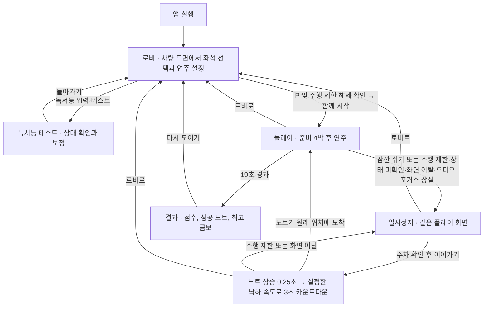
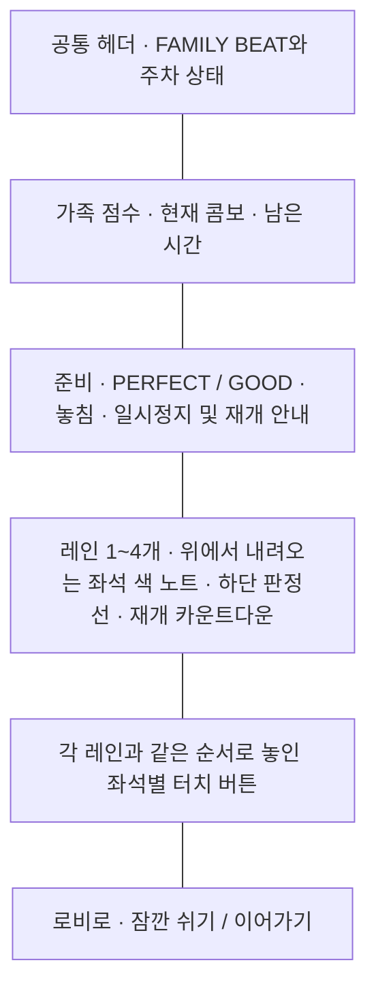
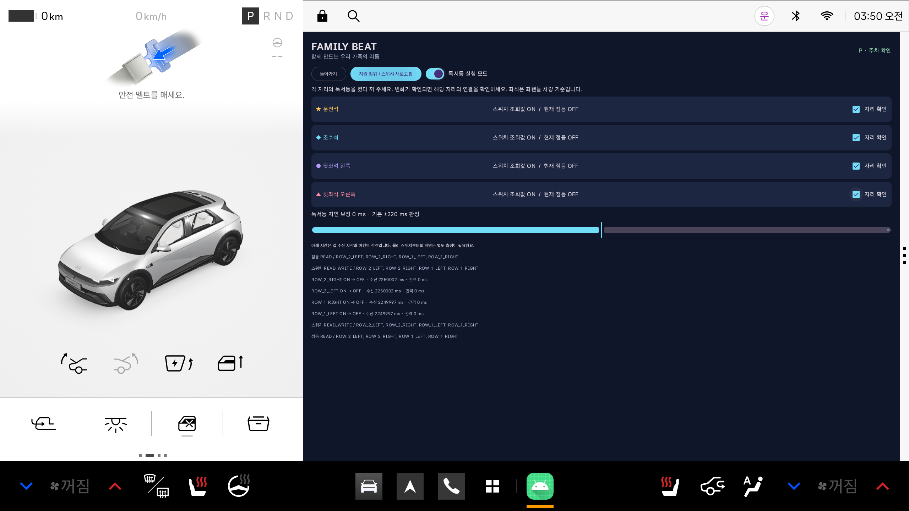
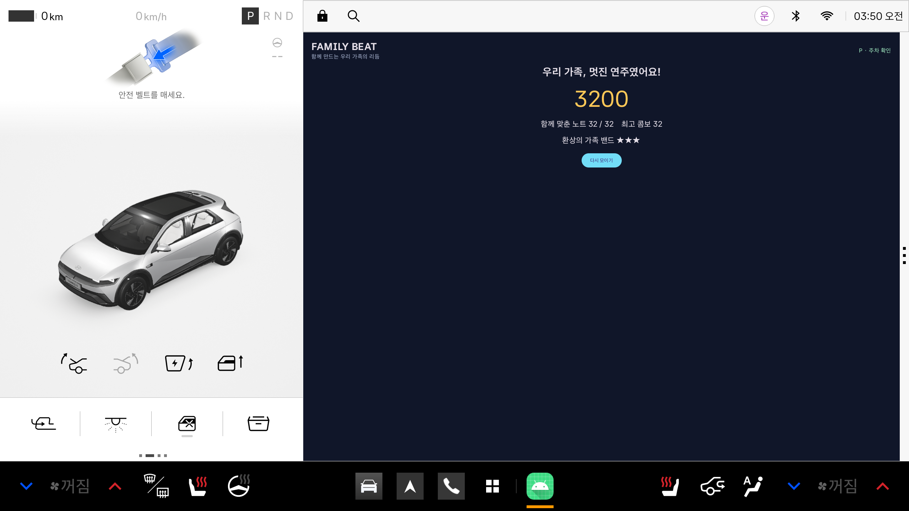
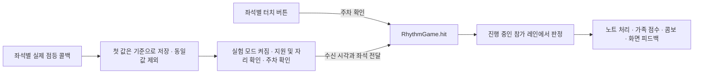

# FAMILY BEAT 프로젝트 현황

FAMILY BEAT는 Pleos Connect 차량 화면에서 1~4명이 각자 맡은 레인을 연주해 하나의 점수와 콤보를 만드는 주차 전용 리듬게임입니다. 기존 HyundaiApp에 구현했으며, 터치와 선택형 독서등 입력으로 에뮬레이터에서 각각 한 판을 끝까지 검증했습니다.

| 항목 | 현재 상태 |
|---|---|
| 구현 기준 | `fb5912f` |
| 프로젝트 / 앱 패키지 | HyundaiApp / `com.example.hyundaiapp` |
| 기술 구성 | Kotlin, Jetpack Compose, Material 3, Vehicle SDK 2.3.2 |
| 빌드 설정 | compileSdk·targetSdk 37, minSdk 28 |
| 확인한 실행 환경 | Pleos Connect v2.1.0 에뮬레이터, API 34 |
| 게임 콘텐츠 | 120 BPM 내장 4박 비트 1곡, 19초, 32노트 |
| 검증 범위 | 에뮬레이터 터치·독서등·P/D 전환 검증. 실차 검증 예정 |

## 화면 이동 다이어그램

앱은 로비에서 시작합니다. 독서등 테스트는 선택 경로이며, 테스트를 마치면 로비에서 게임을 시작합니다. 일시정지는 별도 화면으로 이동하는 대신 같은 레인에서 곡 시간과 입력을 멈추는 상태입니다. 이어가기의 3초 카운트다운이 끝나면 기존 곡 위치와 점수를 이어받고, 로비에서 새로 시작하면 초기화됩니다. 주행 상황에 따라 Pleos가 앱 대신 시스템 제한 화면을 표시할 수 있습니다.

모든 앱 화면 상단에는 **FAMILY BEAT**, 부제와 주차 상태가 표시됩니다. **함께 시작**, **이어가기**는 주차가 확인되어야 활성화되며, 플레이 터치 버튼은 게임이 진행 중일 때만 사용할 수 있습니다.

## 화면별 구현 기능

### 로비

- 차량을 위에서 본 도면에 네 좌석 버튼을 실제 좌우·앞뒤 순서로 배치합니다. 차량 앞쪽은 위이며 운전석은 왼쪽 앞입니다. 버튼에 좌석 색·아이콘·이름과 참가 또는 입력 상태를 표시합니다. 기본은 네 자리 참가이며 마지막 한 자리는 해제할 수 없습니다.
- 참가 여부와 독서등 연결 여부는 별개입니다. 실험 모드가 켜져 있고 자리 확인이 끝난 경우 **독서등 + 터치**, 참가 중인 나머지 자리에는 **터치로 참여**를 표시합니다.
- **연습 모드**는 같은 곡의 판정 시간을 기본 ±220ms에서 ±350ms로 넓힙니다. **함께 시작**과 **독서등 입력 테스트**는 각각 플레이와 테스트 화면을 엽니다.

| 좌석 버튼 | 색 | SDK 영역 | Virtual Console 영역 |
|---|---|---|---|
| ★ 운전석 | 노랑 | `ROW_1_LEFT` | `front_left` |
| ◆ 조수석 | 하늘 | `ROW_1_RIGHT` | `front_right` |
| ● 뒷좌석 왼쪽 | 보라 | `ROW_2_LEFT` | `rear_left` |
| ▲ 뒷좌석 오른쪽 | 분홍 | `ROW_2_RIGHT` | `rear_right` |

**노트 낙하 속도** 슬라이더로 0.50~2.00배를 0.25배 단위로 선택할 수 있습니다. 기본은 1.00배이며, 낮은 배속에서는 노트가 더 일찍 나타납니다. 곡의 BPM과 판정 시각은 그대로 유지됩니다.

운전석·조수석 이름은 좌핸들 기준입니다. 도면에서 선택한 자리만 레인에 배치되며, 32개 노트를 참가 좌석 순서대로 번갈아 배정합니다.

### 플레이

이 다이어그램은 화면의 위에서 아래 순서를 보여 줍니다. 점수와 콤보는 왼쪽, 남은 시간은 오른쪽에 표시합니다. 화면 중앙에는 참가 레인만 같은 너비로 배치하고, 각 레인 아래에는 해당 자리의 색과 아이콘이 들어간 터치 버튼을 둡니다.

- 준비 4박이 지난 2초 지점에서 첫 노트가 판정선에 닿습니다. 이후 500ms마다 노트가 하나씩 도착합니다. 내장 비트는 `ToneGenerator`로 생성하고 4박마다 첫 박을 강조합니다.
- 입력한 좌석에서 아직 판정되지 않은 가장 가까운 노트를 찾습니다. 오차가 100ms 이내면 **PERFECT 100점**, 그 밖에 허용 폭 안이면 **GOOD 60점**입니다. 성공한 노트는 한 번만 채점하며 가족 전체의 현재·최고 콤보에 반영합니다.
- 허용 폭 밖에서 누르면 **박자를 기다려요** 안내가 표시됩니다. 노트가 판정 기한을 넘겨 놓친 것으로 처리되면 현재 콤보가 0으로 돌아갑니다.
- **잠깐 쉬기**는 곡 시간·비트·입력을 멈춥니다. **이어가기**를 누르면 노트가 0.25초 동안 위로 올라간 뒤, 3 → 2 → 1 카운트다운 동안 로비에서 설정한 낙하 속도로 정지 위치까지 내려옵니다. 이때 곡 시간과 판정은 멈춰 있으며, 카운트다운이 끝난 뒤부터 들어오는 입력으로 판정을 계속합니다. **로비로**는 진행 중인 판에서 나갑니다.

### 독서등 입력 테스트

| 화면 위치 | 표시와 동작 |
|---|---|
| 상단 조작 줄 | **돌아가기**, **지원 범위 / 스위치 새로고침**, **독서등 실험 모드** 스위치 |
| 좌석별 네 줄 | 색과 아이콘, **스위치 조회값**, **현재 점등**, **자리 확인** 체크박스 |
| 좌석 목록 아래 | **독서등 지연 보정** 슬라이더(-300~+300ms, 기본 0ms)와 현재 판정 폭 |
| 하단 로그 | 최신 최대 8개 기록. 지원 영역, 이전·이후 값, 앱 수신 시각, 변화 간격, 조회 오류 등을 표시 |

앱은 `checkReadingLightSwitchCapabilities`와 `checkReadingLightStateCapabilities`를 각각 호출합니다. 스위치 조회값은 `getReadingLightSwitch`로 읽은 설정의 스냅샷입니다. 현재 점등은 `registerReadingLightState` 콜백으로 갱신되는 실제 상태입니다.

한 자리씩 독서등을 켜고 끄며 해당 영역에 변화가 찍히는지 확인합니다. 상태 조회가 지원되고 변화가 관찰된 자리만 체크할 수 있습니다. 확인은 앱 세션 동안 적용되며, 해당 자리의 상태를 알 수 없게 되거나 상태 구독이 실패하면 해제됩니다. 실험 모드를 켜면 확인한 자리에서 터치와 독서등을 함께 쓸 수 있습니다. 미지원·미확인 자리의 입력은 터치입니다.

### 결과

가족 점수, 맞춘 노트 수와 전체 노트 수, 최고 콤보를 표시합니다. 24개 이상 맞추면 **환상의 가족 밴드 ★★★**, 그보다 적으면 **다음 연주도 함께해요 ★**가 표시됩니다. **다시 모이기**를 누르면 로비에서 참가 좌석과 연습 모드를 다시 설정할 수 있습니다.

## 입력과 주차 제한 동작

- 게임 시간과 입력은 `SystemClock.elapsedRealtime()`을 기준으로 비교합니다. 독서등은 메인 스레드에서 처리하는 시각 대신 콜백을 수신한 시각을 사용합니다. 보정값이 +50ms이면 독서등 입력을 곡에서 50ms 앞선 시점으로 판정합니다. 터치 입력 시각에는 이 보정이 적용되지 않습니다.
- 차량 입력은 실제 점등 상태 변화입니다. 같은 값이 계속 들어오면 추가 입력이 없으며, 최초값은 변화 비교의 기준으로 저장합니다. 좌석 영역은 어느 조명이 바뀌었는지 나타냅니다. 자동 점등 같은 다른 원인도 상태를 바꿀 수 있고, API에서 물리 버튼의 누름·뗌이나 조작자는 제공되지 않습니다.
- 주차 조건은 **기어 P + 주행 제한 해제 + 요청 시점 기준 2초 미만의 기어값**입니다. 기어는 500ms 주기로 읽고, 주행 제한은 `CarUxRestrictionsManager`의 조회와 콜백으로 확인합니다. 조건이 깨지거나 조회가 실패하면 일시정지합니다.
- 앱이 화면에서 벗어나거나 오디오 포커스를 얻지 못하거나 잃으면 비트와 게임을 일시정지합니다. 종료 시 독서등·주행 제한 리스너, 차량 SDK와 오디오 자원을 정리합니다.
- 차량 권한은 읽기용 `CAR_LIGHTS`, `CAR_DRIVE`를 사용합니다. 창문 위치, 브레이크, 페달은 게임 입력 범위 밖이며 차량 제어는 앱 기능에 포함되지 않습니다.

## 코드 위치

| 파일 | 담당 |
|---|---|
| [MainActivity.kt](../app/src/main/java/com/example/hyundaiapp/MainActivity.kt) | Compose 화면 전환, UI, 비트, 오디오 포커스와 앱 생명주기 |
| [VehicleSeatMap.kt](../app/src/main/java/com/example/hyundaiapp/VehicleSeatMap.kt) | 차량 도면과 위치별 좌석 선택 버튼 |
| [RhythmGame.kt](../app/src/main/java/com/example/hyundaiapp/RhythmGame.kt) | 노트 배정, 곡 시계, 터치·독서등 공통 판정, 점수와 결과 |
| [VehicleInputs.kt](../app/src/main/java/com/example/hyundaiapp/VehicleInputs.kt) | 주차 확인, capability 조회, 좌석 상태 구독 및 진단 |
| [SignalEdges.kt](../app/src/main/java/com/example/hyundaiapp/SignalEdges.kt) | 구독 첫 값과 동일값 반복을 판정에서 제외 |
| [RhythmGameTest.kt](../app/src/test/java/com/example/hyundaiapp/RhythmGameTest.kt) | 판정과 입력 필터 회귀 테스트 |

## 검증 결과와 남은 확인

| 확인 항목 | 기존 에뮬레이터 검증 결과 |
|---|---|
| 4인 터치 완주 | 32/32, 3,200점, 최고 콤보 32 |
| 독서등 실험 완주 | 32/32, 3,160점, 최고 콤보 32. 네 영역 모두 지정된 레인으로 판정 |
| 동일값 재전송 | 상태값을 반복 전송해도 중복 득점 없음 |
| 주행 제한 | P→D에서 Pleos 제한 화면 표시. P 복귀 후에도 수동으로 이어가기 필요 |
| Console 전달 시간 | 활성 세션의 관찰 상한 21~35ms(8개 표본). ADB와 HTTP 시간을 포함 |
| 빌드 | `testDebugUnitTest`, `lintDebug`, `assembleDebug` 성공. 단위 테스트 8개, Lint 오류 0개 |

- **에뮬레이터 추가 확인**은 서비스 단절·UNKNOWN 기어·일부 영역 미지원 상태의 통합 시험, Console 재연결, 동시 입력, 화면 크기 변경, 오디오 포커스 개입입니다.
- **실차 추가 확인**은 모델별 영역과 실제 좌석 대응, 물리 조작부터 상태 콜백까지의 지연, 자동 점등 영향, 원래 버튼 동작, 주행 제한·서스펜드·서비스 재연결입니다. 실차에서 독서등 입력이 검증된 좌석은 아직 없습니다.
- 기어 조회는 SDK에서 deprecated로 표시된 API를 사용합니다. Console 활성화 직후 전달 지연이 커지는 사례와 기존 Lint 경고의 상세 내역은 검증 기록에 남겼습니다.

빌드·실행 명령은 [README](../README.md), 스크린샷과 측정 방법은 [검증 기록](verification.md), 이벤트별 근거는 [에뮬레이터 로그](emulator-verification.log)에 있습니다.
