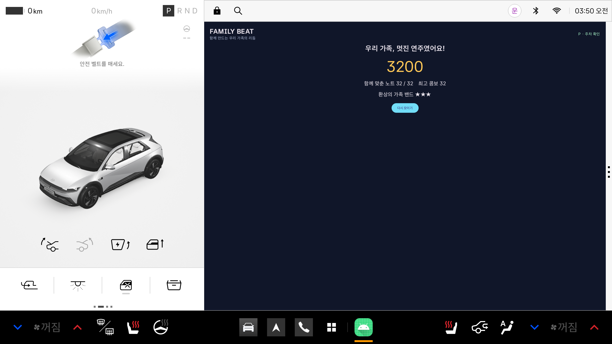
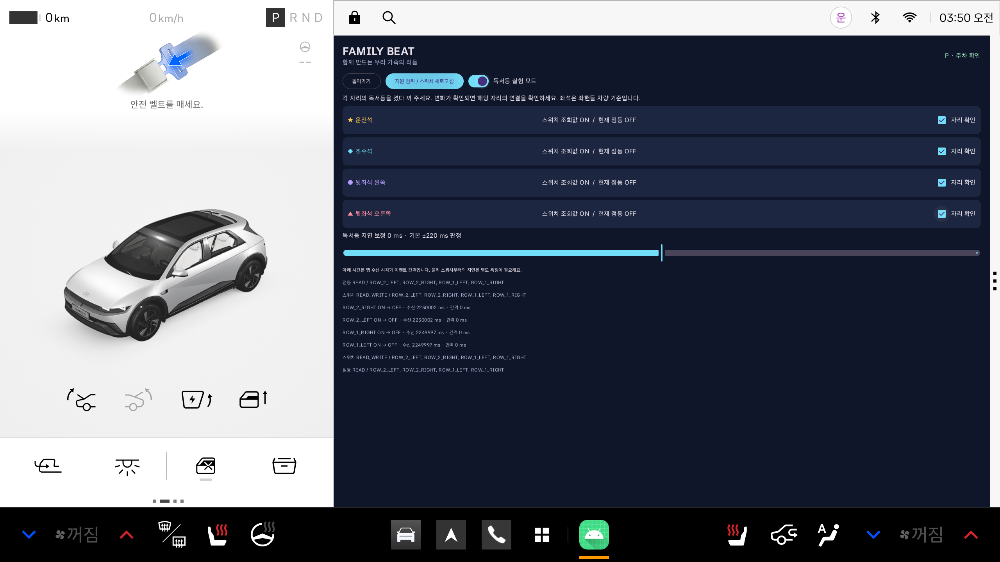
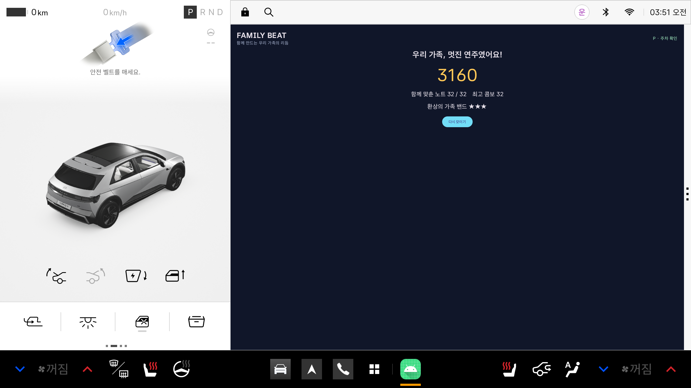
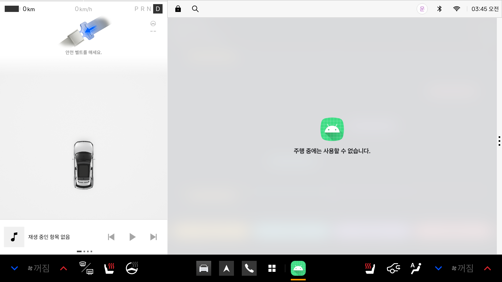

# 검증 기록 — 2026-11-09

환경: Pleos Connect v2.1.0 에뮬레이터(API 34), Vehicle SDK 2.3.2, Windows / ADB.
앱의 터치 이벤트와 Virtual Console의 HTTP 인터페이스를 통해 검증했습니다. 실제 차량/물리 스위치는 사용하지 않았습니다.

## 최종 빌드 결과

- `testDebugUnitTest`, `lintDebug`, `assembleDebug` 성공.
- 신규 판정/신호 회귀 테스트 7개 통과(기존 템플릿 테스트 포함 전체 8개).
- Lint 오류 0개. 기존 의존성 업데이트, 미사용 템플릿 리소스 경고가 남아 있습니다. 구형 lifecycle의 커스텀 Lint 2개는 현재 도구와 호환되지 않아 건너뛰어졌습니다.
- SDK의 기어 조회 API는 deprecated 경고가 있으나 이 이미지에서 P/D 조회를 확인했습니다. 향후 SDK 전환 시 GEAR_SELECTION 경로 및 권한을 다시 검증해야 합니다.

## 플레이와 좌석 매핑

최종 APK에서 4명 터치 플레이: **32/32, 3,200점, 최고 콤보 32**.
최종 APK에서 독서등 실험 플레이: **32/32, 3,160점, 최고 콤보 32**.
각 상태 변화에 같은 값을 한 번 더 전송했지만 노트당 판정은 한 번만 발생했습니다.

| 플레이어 | SDK 영역 | Console 영역 | 검증 결과 |
|---|---|---|---|
| 운전석 ★ | ROW_1_LEFT | front_left | 터치 + 상태 변화가 seat=0으로 판정 |
| 조수석 ◆ | ROW_1_RIGHT | front_right | 터치 + 상태 변화가 seat=1으로 판정 |
| 뒷좌석 왼쪽 ● | ROW_2_LEFT | rear_left | 터치 + 상태 변화가 seat=2으로 판정 |
| 뒷좌석 오른쪽 ▲ | ROW_2_RIGHT | rear_right | 터치 + 상태 변화가 seat=3으로 판정 |

스위치 capability는 네 영역 READ_WRITE, 점등 상태 capability는 네 영역 READ였습니다. 앱은 쓰기 가능 여부와 관계없이 읽기 API만 호출합니다.
테스트 화면에서 각 상태 변화를 관찰한 뒤 네 자리 확인을 선택했습니다. 최초 상태값은 점수에 반영하지 않습니다.
에뮬레이터에서 영구적으로 터치 전용인 자리는 없었습니다. 기본 모드와 미확인/미지원 상태에서는 네 자리 모두 터치를 사용합니다. 실차에서 검증된 자리는 아직 없습니다.

## 시간과 지연

앱의 곡 시간과 콜백 수신 시간은 모두 `SystemClock.elapsedRealtime()`입니다. 콜백이 메인 스레드에서 처리되는 시각 대신 수신 순간을 저장하고, 다음 프레임 이후에 처리돼도 그 시각으로 판정합니다.

활성화된 Console에서 ADB로 읽은 `/proc/uptime`을 요청 직전 기준점으로 삼아 callback 수신 시각과 비교한 8개 표본:
**35, 27, 22, 21, 25, 22, 22, 22ms**.
이는 ADB 반환·호스트 요청·HTTP 전달 시간을 포함한 관찰 상한이며, 순수 SDK 지연이나 물리 버튼 지연이 아닙니다. `/proc/uptime` 표시에 따른 약 10ms 해상도 제한도 있습니다.

Console 세션이 비활성화됐다가 살아나는 첫 요청에서는 더 큰 지연과 한 번의 MISS를 관찰했습니다. 최종 플레이의 판정 오차는 첫 입력 191ms, 나머지 21–54ms였습니다. 이 수치는 테스트 입력 스케줄 오차도 포함합니다.
측정 결과 기본 ±220ms, 연습 ±350ms를 유지했고, 물리 버튼 지연으로 오인한 일괄 보정은 넣지 않았습니다. 차량 입력별 추가 보정은 화면의 ±300ms 슬라이더로 가능합니다.

## 주행 제한

플레이 중 Console 기어를 P→D로 변경하자 Pleos의 `주행 중에는 사용할 수 없습니다` 화면이 표시됐습니다. P로 복구하고 앱을 다시 표시한 뒤에도 게임은 일시정지 상태였고 `이어가기`가 필요했습니다.
앱은 P 여부를 500ms 주기로 조회하고, 요청 기준 2초를 넘은 값·조회 실패·알 수 없는 기어는 주차로 취급하지 않습니다. UX 제한 콜백 또는 조회 실패도 게임을 정지시킵니다.

## 추가 확인할 사항

### 에뮬레이터

- 차량 서비스 강제 단절, UNKNOWN 기어, capability 일부 미지원 상태의 통합 시험. 기본 이미지의 `car_service help`는 non-user build 제한으로 실행되지 않아 강제 주입 시험은 하지 않았습니다.
- Console 장시간 세션/재연결, 여러 독서등 동시 변화, 화면 크기 변경 및 실제 여러 손가락 동시 터치.
- 오디오 포커스 상실 코드가 적용돼 있으나 통화/내비 음성 개입의 실제 시나리오와 장시간 오디오 동기화는 추가 확인이 필요합니다.

### 실차

- 차량별 capability, 권한 부여, ROW 영역과 실제 좌석 대응(우핸들 포함)을 다시 확인.
- 독서등 물리 스위치→실제 점등→SDK 콜백 지연과 변동 폭을 측정하고 판정 폭/보정값 조정.
- 문 열림/전체 조명/자동 점등 같은 다른 원인과 손으로 조작한 입력을 구분할 수 있는지 확인. 현재 API 사용만으로 조작한 사람이나 누름/뗌을 알 수 없습니다.
- 읽기 전용 앱 실행 중에도 기존 버튼 기능이 그대로 동작하는지, 주행 제한/서스펜드/차량 서비스 재연결에서 게임이 정지하는지 확인.

앱은 실제 장치를 움직이거나 원래 기능을 비활성화하지 않습니다. 테스트용 상태 변경은 에뮬레이터 Console에서만 수행했습니다. 검증 종료 시 기어 P, 네 독서등 OFF로 복구했습니다.
